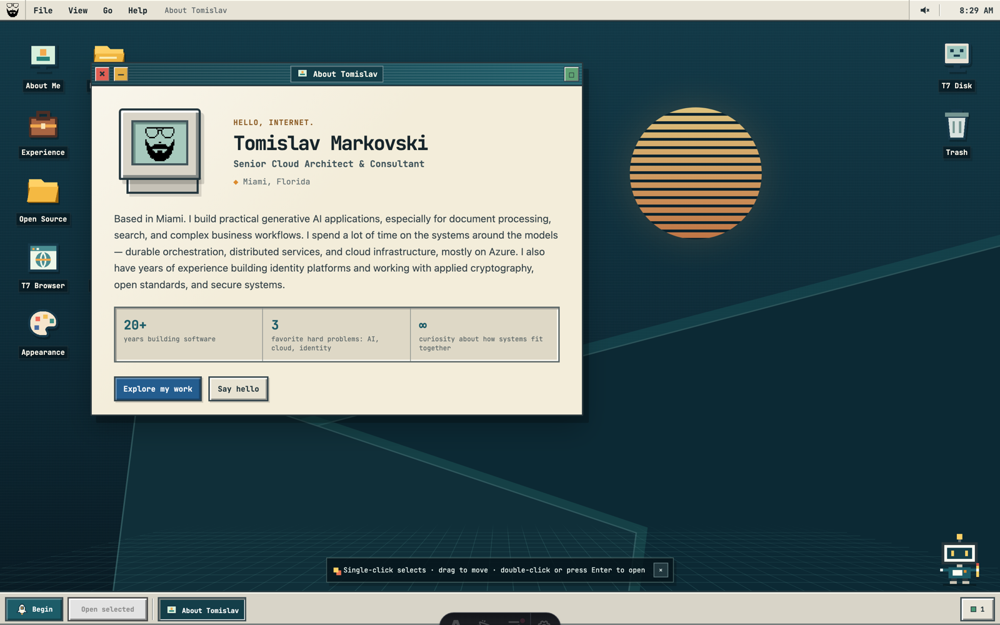
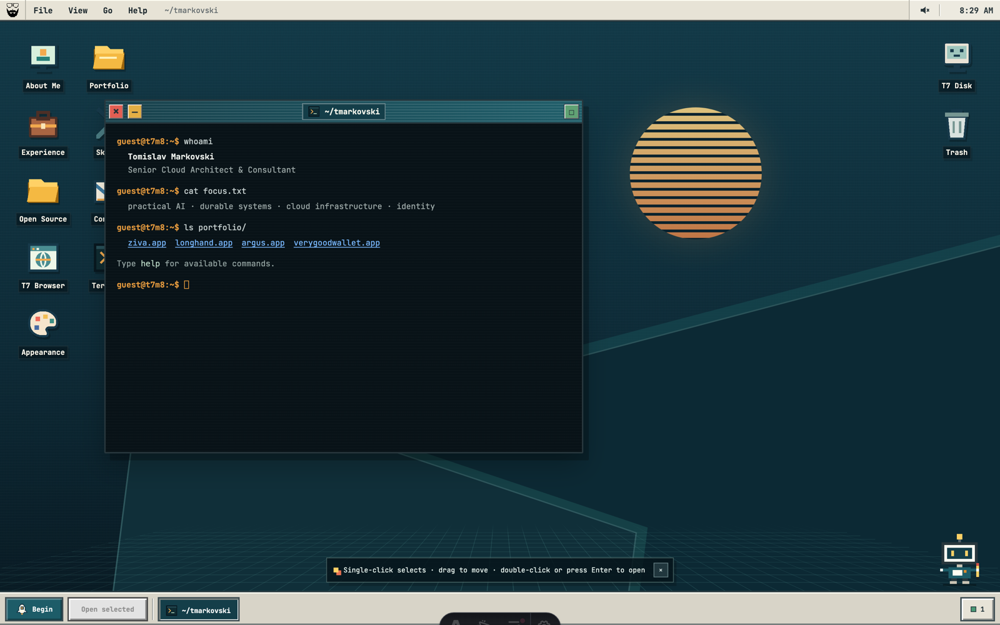
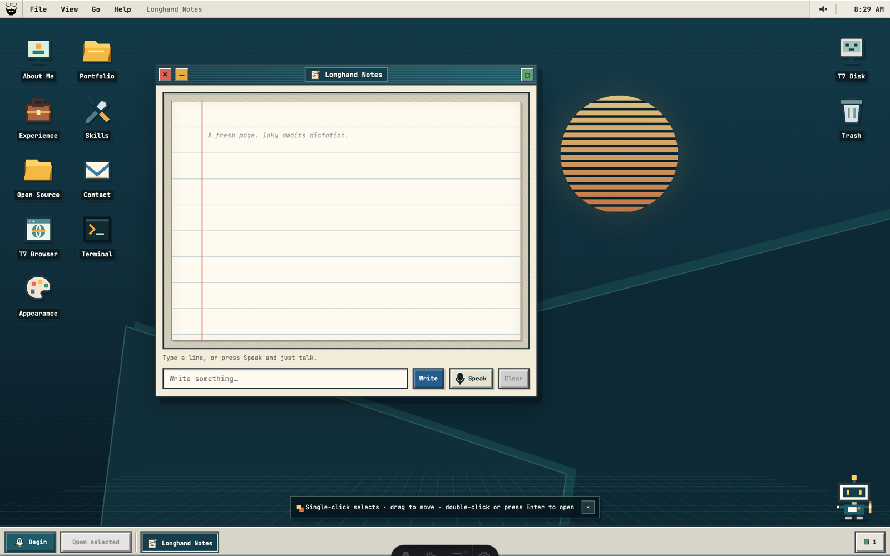

### `guest@t7m8:~$ whoami`

Hi, I'm **Tomislav** — cloud architect and consultant in Miami, Florida. 🌴

I build practical generative AI applications — document processing, search, and complex business workflows — and I spend most of my time on the systems *around* the models: durable orchestration, distributed services, and cloud infrastructure, mostly on Azure. In a previous arc I co-founded Trinsic and spent years deep in decentralized identity and applied cryptography, writing a fair amount of the open-source plumbing along the way.

### `guest@t7m8:~$ cat focus.txt`

`practical AI` · `durable systems` · `cloud infrastructure` · `identity & cryptography`

### `guest@t7m8:~$ ls portfolio/`

| | |
| --- | --- |
| 🍏 **[Ziva](https://ziva.fit)** | Nutrition tracking through conversation. Describe a meal in Claude or ChatGPT and Ziva resolves it to USDA food data with a full nutrient breakdown. |
| ✍️ **[Longhand](https://trylonghand.com)** | Neural handwriting synthesis for web and mobile. Typed text goes in, expressive human-looking handwriting comes out. |
| 👁️ **[Argus](https://github.com/tmarkovski/dbos-argus)** | A self-hosted dashboard for DBOS durable workflows. Point it at Postgres or SQLite and watch your workflows think. |
| 💳 **[Very Good Wallet](https://verygoodwallet.com)** | A credential wallet where your passkey *is* the wallet — no seed phrase, no custody, plus BBS selective disclosure and in-browser zero-knowledge proofs. |

### `guest@t7m8:~$ ls open-source/`

- **[aries-framework-dotnet](https://github.com/hyperledger/aries-framework-dotnet)** — a .NET framework for decentralized identity and verifiable credentials (author & maintainer)
- **[did-key.rs](https://github.com/decentralized-identity/did-key.rs)** — a Rust implementation of the `did:key` method (author, DIF contributor)
- **[bbs](https://github.com/trinsic-id/bbs)** — BBS signatures in Rust, with selective disclosure and zero-knowledge proofs (author, IETF contributor)

Standards mileage: W3C Credentials CG · Decentralized Identity Foundation · Hyperledger · IETF

### `guest@t7m8:~$ open https://t7m8.com`

My website is a small operating system. It has draggable windows, a terminal, a web browser, a trash can (empty), and a handwriting notepad with a desk buddy named Inky. It even works with JavaScript turned off — it boots into "safe mode", grudgingly.

<table>
  <tr>
    <td width="50%"></td>
    <td width="50%"></td>
  </tr>
</table>

### `guest@t7m8:~$ ping tomislav`

[t7m8.com](https://t7m8.com) · [LinkedIn](https://www.linkedin.com/in/tmarkovski/) · [Medium](https://medium.com/@tmarkovski) · [X](https://x.com/tmarkovski)
